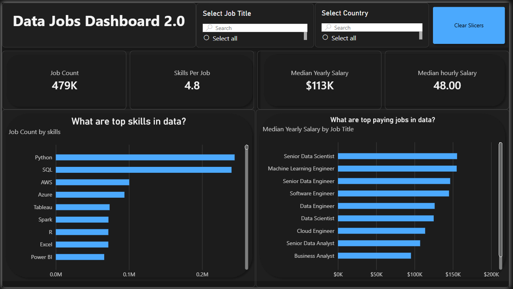

# Data Jobs Market Analysis | Power BI

## Project Overview

This project presents an interactive Power BI dashboard designed to analyze the data job market, focusing on salary trends, technical skill demand, and compensation across different data-related careers.

The goal is to transform job market data into accessible insights that help professionals understand industry trends and career opportunities.

## Dashboard Preview

## Key Performance Indicators (KPIs)

| Metric | Value |
|---|---|
| Total Job Listings | 479K |
| Skills per Job | 4.8 |
| Median Yearly Salary | $113K |
| Median Hourly Salary | $48.00 |

*These figures represent the dashboard's displayed data and filter context.*

## Key Insights

### 1. Most In-Demand Skills
- Python and SQL are the two most frequently requested technical skills.
- AWS and Azure show significant demand for cloud-related skills.
- Tableau, Excel, and Power BI are also represented in job postings.

### 2. Salary Analysis
- Senior Data Scientist and Machine Learning Engineer appear among the highest-paying roles.
- Senior Data Engineer and Software Engineer also show competitive salaries.
- Salary levels vary significantly across job categories.

### 3. Interactive Analysis
The dashboard allows users to:
- Filter job opportunities by job title.
- Explore job market information by country.
- Compare median salaries across career paths.
- Identify the most frequently required technical skills.

## Tools & Technologies

- **Power BI:** Interactive dashboard development and visualization
- **Power Query:** Data transformation and preparation
- **DAX:** KPI calculations and analytical measures

## Project Objectives

- Analyze salary differences across data-related careers.
- Identify the technical skills most frequently requested by employers.
- Develop interactive visualizations to communicate job market trends.
- Support data-driven career exploration.

## Future Improvements

- Analyze remote versus on-site opportunities.
- Add country-specific salary comparisons.
- Explore relationships between technical skills and compensation.
- Include additional job market trends over time.

- ## Download Power BI Project

Download the original Power BI dashboard to explore the data model, DAX calculations, and interactive visualizations in Power BI Desktop.

[📥 Download Power BI Dashboard](https://1drv.ms/u/c/86b04e3510d9e45b/IQCI9HJDxWWCR6C6fObXIXzVAY7ZgGMlunuIB4PPtBGtgKM?e=n06bMF)

**Note:** Power BI Desktop is required to open the `.pbix` file.
